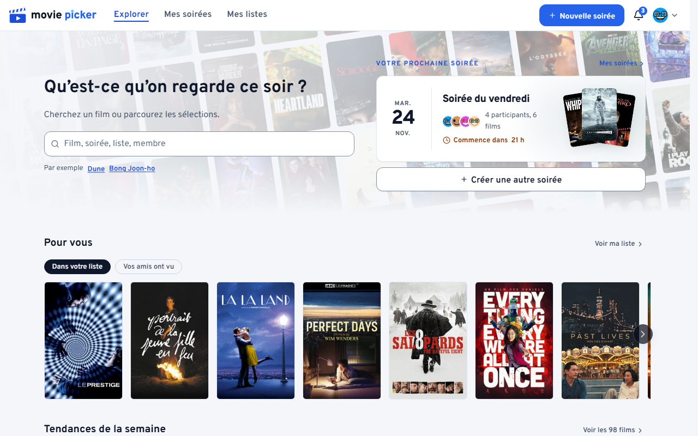
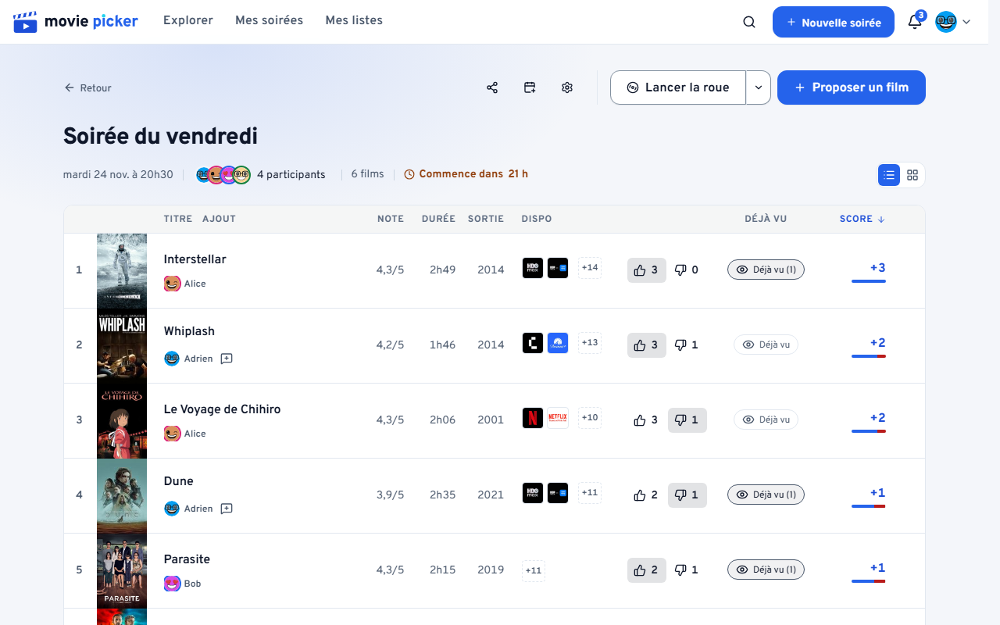
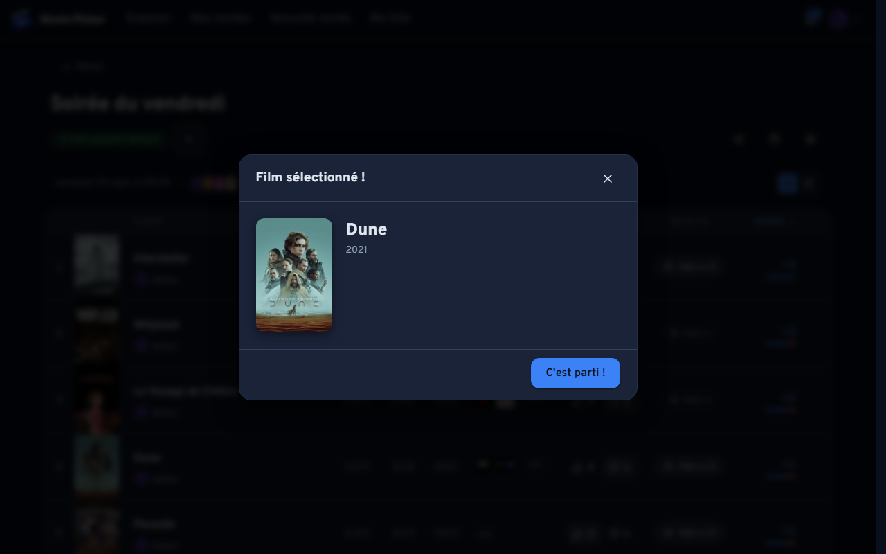
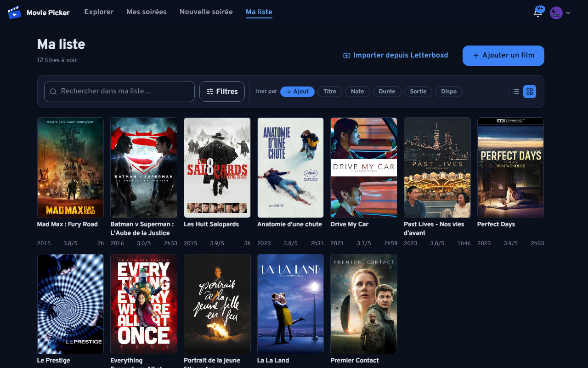
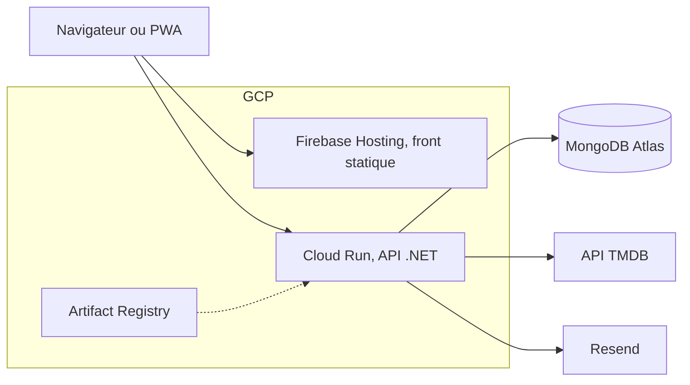

<p align="center">
  
</p>

<h1 align="center">Movie Picker</h1>

<p align="center">
  Choisir un film à plusieurs sans y passer la soirée.<br>
  <a href="https://www.movie-picker.fr/"><strong>Ouvrir l’application</strong></a>
  &nbsp;&nbsp;&nbsp;
  <a href="https://www.movie-picker.fr/tech"><strong>Lire le dossier technique</strong></a>
</p>

<p align="center">
  <a href="https://github.com/Affy657/Movie-Picker/actions/workflows/ci-cd.yml"></a>
  <a href="https://sonarcloud.io/summary/new_code?id=Affy657_Movie-Picker"></a>
  <a href="https://sonarcloud.io/summary/new_code?id=Affy657_Movie-Picker"></a>
  <a href="https://github.com/Affy657/Movie-Picker/releases"></a>
</p>

## L’auteur

**Adrien Morand**, développeur backend .NET / C# à Bordeaux, **en recherche d’un CDI**.
Movie Picker est mon projet personnel, conçu, développé et exploité seul, en production depuis
2026. Ce qu’il montre de mon travail :

- une API ASP.NET Core sur .NET 10 en architecture hexagonale, dont les frontières sont vérifiées
  à chaque build, testée contre une vraie MongoDB ;
- une chaîne de livraison complète : CI aux portes bloquantes, recette puis production sur Google
  Cloud, infrastructure en Terraform, identités sans clé, retour arrière exercé ;
- l’exploitation d’un service réel : sauvegardes vérifiées, alertes, Sentry, mesures d’usage ;
- un front React et TypeScript tenu aux mêmes exigences (design system, accessibilité, iPhone).

[Dossier technique](https://www.movie-picker.fr/tech)
&nbsp;&nbsp;&nbsp;
[LinkedIn](https://www.linkedin.com/in/adrien-morand/)

### In English

Movie Picker is a web app to pick a film as a group: create a movie night, share the link,
everyone suggests and votes, the wheel decides. It is the personal project of Adrien Morand, a
backend .NET / C# developer based in Bordeaux, France, looking for a permanent position. Under the
hood: an ASP.NET Core API on .NET 10 with a hexagonal architecture checked at build time, MongoDB
Atlas, a React and TypeScript front end, Google Cloud (Cloud Run, Firebase Hosting) described in
Terraform, and a CI/CD chain with blocking quality gates (SonarCloud, coverage thresholds,
integration tests on a real MongoDB, end-to-end tests). The app and its technical write-up are in
French; the app also has an English version, chosen in the footer.

## Le produit

On crée une soirée, on partage le lien, chacun propose des films et vote, la roue tranche.

1. **Créer une soirée** (titre, date, heure) et récupérer son lien de partage.
2. **Rejoindre** depuis ce lien, avec un compte.
3. **Proposer des films** via la recherche TMDB (affiches, métadonnées, disponibilité en streaming).
4. **Voter** pour ou contre, et signaler un film déjà vu.
5. **Lancer la roue**, en tirage strictement aléatoire ou pondéré par les votes, au choix de l’hôte.
6. **Couronner** un ou plusieurs films, jusqu’à dix selon le réglage de l’hôte : chaque tirage en ajoute un au palmarès.

|  |  |
| :--: | :--: |
|  |  |
| Ce qu’on peut regarder ce soir | Les films proposés, les votes, les participants |
|  |  |
| La roue tranche | Ses listes de films, notées et importables depuis Letterboxd |

Captures prises sur l’application lancée en local, par
[`scripts/capture-screenshots.mjs`](scripts/capture-screenshots.mjs).

Autour de ce parcours :

- **Soirées** : récurrence au rythme choisi, modèles réutilisables, limite de votes par
  participant, export calendrier `.ics`, page qui réunit les films de toutes ses soirées.
- **Groupes d’amis** : une soirée créée pour un groupe prévient ses membres sans lien à envoyer ;
  chaque groupe a sa page, ses chiffres et un classement de ses membres sur la stat de son choix.
- **Listes** : plusieurs listes par compte, partagées avec d’autres membres ou rendues publiques,
  films vus, films proposés et propositions gagnantes, notes sur 5 ou sur 10, import Letterboxd.
- **Recherche** : une loupe dans la barre de navigation cherche à la fois films et séries,
  membres, soirées, groupes, listes et sagas.
- **Exploration** : page d’accueil avec rangées personnalisées, 120 sagas, sélections thématiques
  et ce qui passe ce soir en streaming.
- **Social** : profils publics `/u/:handle` avec bannière et statistiques expliquées, suivi entre
  comptes, notifications push et in-app.
- **Confort** : thème clair ou sombre, couleur d’accent, installation en PWA, navigation clavier
  testée, axe sur 29 vues et états de l’application.
- **RGPD** : export et suppression de compte.

## La stack

| Couche | Technologies |
| --- | --- |
| Front | React 19, TypeScript, Vite, TanStack Query, React Router, PWA via Workbox. Build statique sur Firebase Hosting |
| API | ASP.NET Core sur .NET 10, architecture hexagonale, conteneur sur Cloud Run déployé par digest |
| Données | MongoDB Atlas, transactions par `IUnitOfWork`, migrations versionnées en base |
| Services | TMDB (films et affiches, proxifiées par l’API), Resend (mails), Sentry, PostHog |
| Outillage | pnpm et Turbo, Vitest, xUnit, NetArchTest, Playwright, Stryker.NET, SonarCloud, Lighthouse, Trivy |



L’API expose `/api/v1`. Son contrat OpenAPI décrit le JSON qu’elle écrit vraiment (propriétés
requises, enveloppe d’erreur, énumérations). Il n’est pas versionné en JSON :
`pnpm run openapi:export` l’écrit dans `artifacts/openapi-v1.json`, ignoré par git, et chaque run
de CI le joint en artefact `openapi-v1`. Ce qui est versionné, ce sont les types TypeScript que le
front en tire (`apps/web/src/shared/api/generated/openapiSchema.ts`) : la liste des routes qu’il
peut appeler, le type de ses réponses et celui des réponses simulées de ses tests. Une route retirée
côté API casse donc la compilation du front, et `check:contract-compat` refuse qu’une route ou un
champ de réponse disparaisse d’une version à la suivante. L’authentification passe par cookie de
session, les actions d’hôte par un jeton envoyé dans l’en-tête `X-Host-Token`.

> **Le dossier technique du projet est publié en ligne, sur
> [www.movie-picker.fr/tech](https://www.movie-picker.fr/tech).** Quatorze sections : architecture,
> choix techniques, interface, serveur, contrat d’API, modèle de données, une fonctionnalité suivie
> de bout en bout, tests, intégration continue, infrastructure, mesures, sécurité, méthode de
> travail et trajectoire. Ce README en est la version courte.

## Travailler avec un agent IA

Ce dépôt est développé avec Claude Code, un agent IA, et l’historique le montre : la plupart des
commits portent sa co-signature, et les branches `claude/...` sont les siennes. Le partage est
simple : je décide du produit, de l’architecture, de ce qui est accepté et de ce qui part en
production ; l’agent exécute, sous des règles écrites. [`AGENTS.md`](AGENTS.md) les rassemble, et
chacune qui peut l’être est vérifiée par une porte automatique plutôt que par la relecture :
`check:architecture`, les tests d’architecture .NET, SonarCloud à zéro issue, les seuils de
couverture, les tests contre une vraie MongoDB. Les procédures répétées (livrer une fonctionnalité,
vérifier un changement, la maintenance) sont des skills de [`.claude/skills/`](.claude/skills/).
Une seule passe agit sans me demander : la maintenance quotidienne, dans les garde-fous écrits de
son skill. La section [Méthode de travail](https://www.movie-picker.fr/tech#method) du dossier
technique détaille ce fonctionnement.

## Démarrer

Node 20.19+, 22.13+ ou 24+, pnpm, et le SDK .NET 10. Rien d’autre.

```bash
pnpm install
pnpm dev:full     # API sur :4000, front sur :5173
```

Sans aucune configuration, l’API tourne entièrement en mémoire et sème comptes et soirées de
démonstration : l’application est cliquable immédiatement, la page de connexion offrant un accès
direct au compte de démonstration. En contrepartie les données repartent de zéro à chaque
redémarrage, et la recherche de films reste vide faute de clé TMDB.

Pour une vraie base et la recherche de films, copier `.env.example` en `.env` puis renseigner
`MONGODB_URI` et `TMDB_READ_ACCESS_TOKEN` (ou `TMDB_API_KEY`). Le reste (lancer Mongo en
conteneur, identifiants de démonstration, catalogue des scripts, structure du dépôt) est dans
[`docs/development.md`](docs/development.md).

## Qualité

La CI de `master` joue toutes les portes sur chaque commit, et le déploiement refuse un commit
dont la CI n’est pas verte. Chaque porte s’appelle par le même `pnpm run` sur le poste et en CI,
donc chaque outil n’est épinglé qu’à un endroit. Ce que la chaîne empêche, plutôt que ce qu’elle
mesure :

- **`check:architecture`** refuse un commentaire dans le code, un `using` qui traverse une couche
  de l’hexagone, une écriture dans une soirée qui ne fait pas avancer son compteur `writeSeq`, une
  dépendance entre features absente de `FEATURE_EDGES`, une valeur littérale dans un CSS module, un
  point de rupture hors de l’échelle fermée, une cible tactile sous 44 px. Chaque règle vit dans un
  module de `scripts/architecture/`, avec un cas qui doit échouer et un qui doit passer.
- **Les tests d’architecture .NET** (`LayerDependencyTests`, NetArchTest) reprennent les règles de
  couches sur l’assembly compilé : le domaine ne dépend que de lui-même et de la bibliothèque de
  base, l’application ne connaît ni ASP.NET Core, ni MongoDB, ni les adaptateurs.
- **Le build Release refuse tout avertissement** (`-warnaserror`, analyseurs .NET et
  SonarAnalyzer), et `dotnet format` vérifie espaces et style.
- **Les tests d’intégration tournent contre une vraie MongoDB** en replica set, seul chemin qui
  exécute les adaptateurs Mongo et les transactions. Un inventaire compare les index réellement
  créés à la liste attendue.
- **Toute la suite Playwright tourne avec navigateur réel et base réelle ensemble**, Chromium et
  WebKit pour les mises en page iPhone.
- **Les seuils de couverture sont des portes** : front 84 % d’instructions et 86 % de lignes, API
  90 % de lignes, adaptateurs Mongo 86 % de lignes, mesurés séparément.
- **SonarCloud reste à zéro issue et à A partout** sur toute la branche, pas seulement sur le
  nouveau code.
- **Sécurité** : Gitleaks sur l’arbre de travail, `actionlint`, `shellcheck` et `zizmor` sur les
  workflows, audit Trivy des dépendances, CodeQL.
- **Avant de figer une version**, `pnpm run release` rejoue le build Release, les diagnostics que
  SonarCloud importe et `dotnet format` si l’API a changé, `tsc` et ESLint si le front a changé.
- **Stryker.NET** est disponible hors CI pour savoir si les tests d’une zone vérifient quelque
  chose ou se contentent de la parcourir.

## Déploiement

- **Pousser sur `master` ne déploie rien.** `.github/workflows/ci-cd.yml` joue les portes de
  qualité ; `.github/workflows/deploy.yml` met en ligne sur déclenchement, la recette
  `staging.movie-picker.fr` d’abord, puis la production, cible par cible (tout, front, API).
- **La production refuse de partir** si la CI du commit n’est pas verte ou si la recette ne sert
  pas exactement ce commit, et elle redéploie l’image que la recette exécute, sans la reconstruire.
  S’y ajoutent les seuils Lighthouse et le scan Trivy de l’image.
- **L’API n’est jamais promue avant d’être vérifiée** : chaque révision est déployée sans trafic,
  éprouvée sur son URL taguée, et ne reçoit d’utilisateurs qu’une fois ses sondes vertes.
- **Le front est publié comme une version immuable** de Firebase Hosting, en-têtes de sécurité et
  paliers de cache compris, puis mis en service d’un coup ; les versions précédentes restent
  servables pour un retour arrière.
- **Les routes publiques indexables sont prérendues** au build : un moteur d’indexation ou un aperçu
  de lien reçoit le contenu et les métadonnées de la page, pas une coquille vide.
- **Flux continu** : chaque fonctionnalité ou correctif rejoint `master` le jour où il est prêt et
  part en production dans la journée. Sa version se calcule depuis le `CHANGELOG.md` ; le tag et
  la release GitHub ne sont créés qu’une fois la production à jour.
- **Workflows annexes** : `backup-mongo.yml` sauvegarde la base chaque jour et restaure l’archive
  pour la vérifier avant de la publier ; `rollback.yml` et `rollback-front.yml` reviennent en
  arrière, API puis front ; `security-scan.yml` tient la veille de vulnérabilités ; `infra.yml`
  planifie et applique l’infrastructure Terraform (`infra/terraform/`) ; `web-legacy.yml` publie
  l’ancienne adresse du site. « Copilot », visible dans l’onglet Actions, n’a pas de fichier dans
  le dépôt : c’est le workflow que GitHub crée lui-même pour une revue de code Copilot, essayée une
  fois le 2026-08-25.

## Documentation

| Document | Contenu |
| --- | --- |
| [Dossier technique](https://www.movie-picker.fr/tech) | La version longue de tout ce qui précède, publiée dans l’application |
| [`AGENTS.md`](AGENTS.md) | Règles du dépôt : conventions, design system, portes de qualité, workflow |
| [`docs/development.md`](docs/development.md) | Installation détaillée, seed, scripts, tests, structure |
| [`docs/design-system.md`](docs/design-system.md) | Jetons et composants partagés du front, props, états et garanties d’accessibilité |
| [`CHANGELOG.md`](CHANGELOG.md) | Journal des versions, Keep a Changelog et SemVer |
| [`docs/roadmap.md`](docs/roadmap.md) | Ce qui vient ensuite, le backlog et les idées écartées |
| [`docs/technical-debt.md`](docs/technical-debt.md) | Dette technique, contraintes et impasses connues |
| [`docs/runbook-mongodb-restore.md`](docs/runbook-mongodb-restore.md) | Remettre une sauvegarde MongoDB dans le cluster de production |
| [`archive/`](archive/) | L’ancienne application mobile et les premiers documents, gelés et conservés pour l’historique, hors du périmètre construit et déployé |
| [`CONTRIBUTING.md`](CONTRIBUTING.md) | Projet personnel : comment signaler un problème ou proposer une idée |
| [`SECURITY.md`](SECURITY.md) | Signaler une faille, par un canal privé |

## Licence

Code publié pour être lu, pas pour être réutilisé : tous droits réservés, voir
[`LICENSE`](LICENSE). C’est un projet personnel : les issues et les retours sont bienvenus, les
contributions de code ne sont pas fusionnées, [`CONTRIBUTING.md`](CONTRIBUTING.md) dit pourquoi et
[`SECURITY.md`](SECURITY.md) comment signaler une faille. Movie Picker utilise l’API de The Movie
Database sans être approuvé ni certifié par TMDB.
